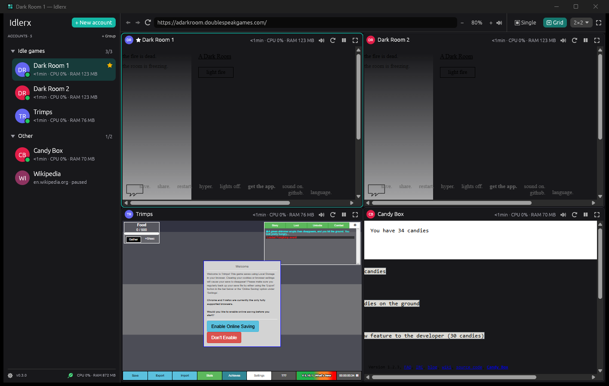
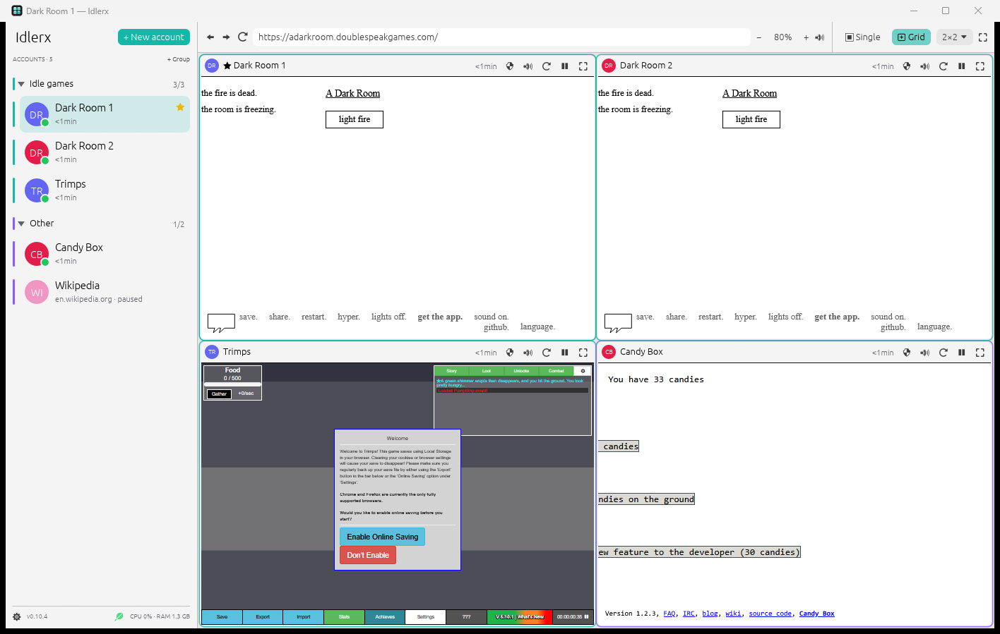
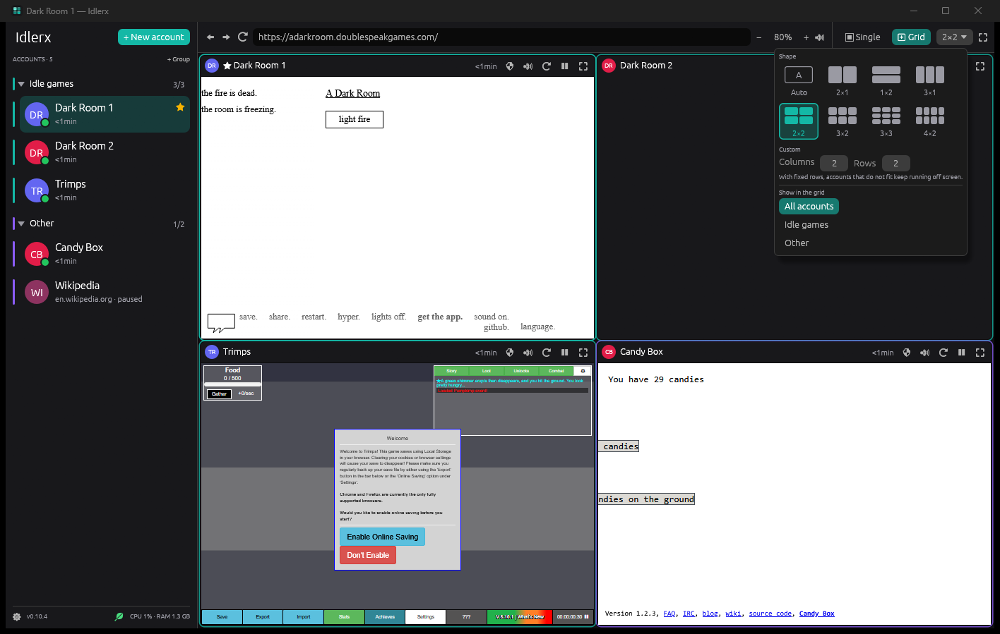
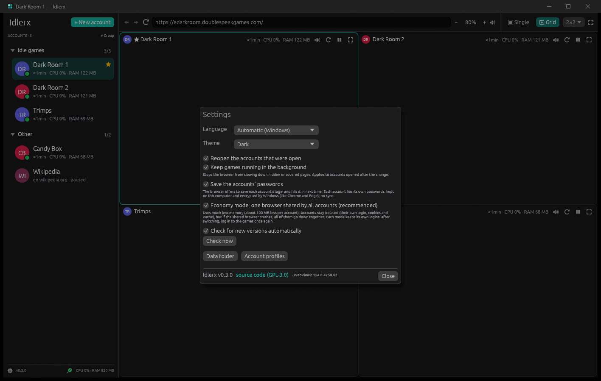

<p align="center">
  
</p>

<h1 align="center">Idlerx</h1>

<p align="center"><b>English</b> | <a href="README.pt-BR.md">Português</a></p>

<p align="center">
  <a href="https://github.com/Antxj/Idlerx/releases/latest"></a>
</p>

Windows app that opens **several accounts of the same site or game at the
same time**, each one **truly isolated** (its own login, cookies, cache and
storage), organized in a single window: one at a time or all side by side in
a grid. Made for people who play browser idle games with more than one
account.

**Free and open source** (GPL-3.0). Written in **Rust**: a single executable,
no installer.

The interface is available in English and Brazilian Portuguese, following
the Windows language (it can be set under **Settings** ⚙ › Language).

| Dark theme | Light theme |
|---|---|
|  |  |

| Grid shape | Settings |
|---|---|
|  |  |

<sub>Games in the pictures: [A Dark Room](https://github.com/doublespeakgames/adarkroom),
[Trimps](https://github.com/Trimps/Trimps.github.io) and
[Candy Box 2](https://github.com/candybox2/candybox2.github.io), all open
source. Two "Dark Room" accounts run side by side, each with its own save.</sub>

## Features

- **Real isolation**: each account has its own browser profile folder. Log
  in to two accounts of the same game at the same time, no private window
  needed, and one never logs the other out
- **Economy mode** (on by default): one browser shared by all accounts,
  each one in its own profile - about 40% less memory. Turn it off under
  **Settings** to give each account its own browser process (if one
  crashes, the others keep going)
- **One at a time or in a grid**: automatic grid that adapts to the window,
  or a fixed shape (side by side, stacked, 2×2, 3×2, 3×3… or any columns ×
  rows). **Drag an account from the list onto a grid cell** to put it there;
  the grid can also show a single group
- **Groups** in the side list: **click a group to show only its accounts
  in the grid** (click again for all of them), the arrow collapses/expands,
  drag groups to reorder them, drag accounts into them, open or pause a
  whole group at once. A new account can go straight into a group (in the
  new account dialog, or right click on the group › New account in this
  group)
- **VPN per group** (OpenVPN): choose a `.ovpn` file for a group and its
  accounts reach the internet only through the VPN, with a **kill switch**:
  if the VPN drops, they stay offline until it is back, never through your
  connection. The rest of the computer and the other groups do not go
  through it. Details in [Group VPN](#group-vpn)
- **Focus mode** (F11): hides the list and the bar, only the game remains.
  F11 or Esc brings everything back
- **CPU and RAM** of each account (in the list and on the grid cell), of
  each group (hover its name) and the **total** (bottom of the list; hover
  it for details). GPU is not measured
- **Sound and zoom per account**: mute one, zoom another (also with
  Ctrl+wheel inside the page). The 🔊 icon shows which one is playing sound
- **Address bar** with back, forward and reload: just paste the URL of any
  game
- **Favorite, rename, reorder** (drag in the list)
- **Saved passwords** (on by default): the browser offers to save each
  account's login and fills it in next time. Each account has its own,
  kept on this computer and encrypted by Windows, like Chrome and Edge
  (no sync)
- **Pause** an account to close its page and free its memory; when opened
  again it is still logged in
- **Clear data** (log out) starts the account fresh without removing it
- **Reopens the accounts** that were open, at the last visited address
- **Automatic updates** through GitHub (details in [Updates](#updates))
- **System tray**: the X sends Idlerx to the tray and the games keep
  running (it can be turned off under **Settings**). Click the icon to
  reopen it; its menu opens or pauses every account and quits. The icon
  gets a red dot while a group's VPN is down, and Windows tells when a VPN
  drops (after 15 s) and when it is back
- **Single instance**: opening the executable again just brings the window
  to the front (also from the tray)

### Saving resources

- **Frame limit**: idle games do not need to draw 60 (or 144, 180… the
  monitor's rate) times a second. By default the selected account draws up
  to 60 FPS and the others up to 30 (both can be changed in Settings);
  each account can also have its own (right click › Frames per second), and
  each grid cell shows how many frames it really draws. With four busy
  pages in the grid, limits of 60 (selected) and 15 (others) took CPU use
  from 25% to 6%

- **Economy mode** shares the browser, GPU and network processes among the
  accounts: with 5 accounts, 21 processes and ~1.5 GB instead of 41 and
  ~2.7 GB. Each mode keeps its own logins, so after switching modes log in
  to the games once again
- Pages that are off screen (another account selected, a menu on top,
  **the window minimized**) **stop drawing** and WebView2 is told to **use
  less memory**, while the game keeps running. Minimized, Idlerx uses about
  ten times less CPU
- "Keep games running in the background" (on by default) stops the browser
  from slowing down the timers of hidden pages, and keeps games awake while
  they are not on screen: a hidden page is told it is still visible and its
  drawing loop runs at 5 frames per second, so games that run their logic
  in it (Phaser and most canvas games) do not freeze or pause themselves.
  Turn it off to save even more CPU
- A page that crashes or stops responding reloads by itself (and the
  account opens again if its browser closed), up to 3 times in 10 minutes
- The interface only repaints when something changes (or once a second for
  the numbers)
- **Pausing** accounts you are not using frees all their memory

## Group VPN

Right-click a group › **Edit (name, VPN)…** › check **Use a VPN (OpenVPN)
in this group** and choose the `.ovpn` file. If the VPN asks for a login,
pick the kind (username and password, Google Authenticator token, or
both); the password and token seed stay on this computer, encrypted by
Windows.

- **When Idlerx opens**, the group's accounts wait for the VPN to connect
  and only then open.
- The **shield** next to the group name shows the state (green: connected,
  amber: connecting or reconnecting, red: error); below the name are the
  **IP** the sites see and the group's **download and upload**. Hover it for
  the totals.
- **Kill switch**: the group's pages can only go out through a local
  "gate" pinned to the VPN network adapter. If the VPN drops, it cuts the
  open connections at once and refuses new ones; there is no path through
  your regular connection. When the VPN is back, the pages reload by
  themselves.
- **No leaks**: DNS is resolved through the VPN, WebRTC does not reveal the
  real IP and IPv6 is blocked (everything goes out over IPv4 through the
  VPN). Checked on browserleaks.com (IP, DNS and WebRTC).
- **The rest of the computer does not change**: Idlerx ignores the routes
  and DNS servers the VPN server pushes and adds only one route through the
  VPN, with the lowest possible priority, used only by the group's gate.
- Each group can have its own VPN, at the same time.
- In **economy mode**, the accounts of a group with a VPN use a browser of
  their own (about 300 MB more per group); after turning a group's VPN on
  or off, log in to the games once again.

Requires **OpenVPN Community**. If it is not installed, Idlerx offers to
install it: the official installer (signed by OpenVPN Inc.) is inside the
executable, and Windows asks for administrator permission. On the first
connection Windows may also ask once to authorize your account for the
OpenVPN service; after that Idlerx connects without asking for permissions.
The VPN runs through OpenVPN's own service, so it works alongside other
VPNs (including OpenVPN GUI).

## Requirements

- **Windows 10 or 11**
- **Microsoft Edge WebView2 Runtime**: ships with Windows 11 and is
  installed by Windows Update on Windows 10. If it is missing, Idlerx shows a
  notice with Microsoft's official link

Idlerx uses the Microsoft Edge (Chromium) engine, so sites behave as they do
in Edge or Chrome.

## How to use

1. Download `Idlerx.exe` from the [Releases](../../releases) page
2. Open it. On the first run, Windows SmartScreen may warn about an
   "unrecognized app": click **More info** › **Run anyway**
3. **+ New account**: paste the game address and give it a name (e.g. "Main
   char")
4. Repeat for the other accounts and pick **▣ Single** or **⊞ Grid** at the
   top right

Right-click an account for more options (edit, mute, hide from grid, clear
data, remove).

## For developers

Requirements: [Rust](https://rustup.rs) with the **MSVC** toolchain and
Visual Studio Build Tools. The GNU toolchain does not work (the WebView2
loader would become a separate DLL); the build stops with a message if it is
the active one.

```powershell
cd rust
rustup override set stable-x86_64-pc-windows-msvc   # only if MSVC is not your default
cargo test
cargo run
.\build-release.ps1      # OpenVPN installer + tests + release without local paths + checks
```

Structure:

- [`main.rs`](rust/src/main.rs): startup and window
- [`app/`](rust/src/app/mod.rs): user interface (egui), split into the
  side list, top bar, grid, dialogs and shared widgets
- [`panels.rs`](rust/src/panels.rs): one open account (WebView2 through
  [webview2-com](https://github.com/wravery/webview2-rs), created
  asynchronously): position, mute, zoom, navigation
- [`config.rs`](rust/src/config.rs): accounts and settings (JSON)
- [`metrics.rs`](rust/src/metrics.rs): CPU and memory per process tree
- [`i18n.rs`](rust/src/i18n.rs): language and the `tr!`/`trf!` text macros
- [`update.rs`](rust/src/update.rs): checking for and installing new versions
- [`vpn/`](rust/src/vpn/mod.rs): VPN of groups: OpenVPN through its
  interactive service, the gate (SOCKS5 proxy pinned to the VPN adapter, kill
  switch), DNS through the tunnel, embedded installer
- [`single.rs`](rust/src/single.rs): single instance

Useful variables for testing:

| Variable | Effect |
|---|---|
| `IDLERX_DATA` | keeps settings and profiles in another folder (the real accounts are not touched) |
| `IDLERX_INSTANCE` | separates a test instance from the everyday app |
| `IDLERX_LANGUAGE` | forces `pt` or `en` |
| `IDLERX_UPDATE_URL` | queries another address instead of the GitHub API |
| `IDLERX_SCREENSHOT` | opens on a given screen for documentation pictures: `settings`, `grid-menu`, `group`, `new-account` or `pointer:x,y` (pointer resting there; `pointer:x,y,right` also right-clicks) |

## Where the data lives

- Settings and account list: `%APPDATA%\Idlerx\config.json`
- Pages log: `%APPDATA%\Idlerx\logs\pages.log` (when each account loaded,
  reloaded and why, was hidden or shown; **Settings** › Pages log)
- Browser profiles (cookies, cache, logins) of each account:
  `%LOCALAPPDATA%\Idlerx\profiles\`
- Group VPN: `%APPDATA%\Idlerx\vpn\` (a copy of each `.ovpn`, passwords
  and seeds encrypted by Windows in `secrets.dat`, OpenVPN logs in
  `logs\`)

Account data **never leaves the computer**.

## Updates

There is no dedicated server: the app queries
`api.github.com/repos/Antxj/Idlerx/releases/latest` right after opening and
then every hour (it can be turned off under **Settings**). The request
sends no user data.

When there is a new version, a discreet link appears on the top bar. With
**Update now**:

1. the release's `Idlerx.exe` is downloaded and only accepted if it has
   exactly the SHA-256 that GitHub publishes for the file;
2. if the running executable is digitally signed, the new one must have a
   valid signature **from the same publisher**;
3. the current executable is renamed to `Idlerx.exe.antigo` (deleted on the
   next start) and the new one takes its place;
4. the app closes and the new version opens by itself, with the same
   accounts.

## Privacy

Idlerx does not collect or send any data. Its only connections are the
**sites you open**, the **version check** on GitHub (described above) and,
in groups with a VPN, **your VPN server** and one request to
`api.ipify.org` **through the VPN itself** on each connection, to show the
IP the sites see (and to check the tunnel works before the pages are let
through).

## Responsible use

Idlerx organizes browser sessions; it **does not automate actions** in games
or capture credentials. Respect each game's terms of service, including
about using several accounts.

## Uninstalling

Close the app and delete `Idlerx.exe`. To also remove the accounts and
profiles, delete the `%APPDATA%\Idlerx` and `%LOCALAPPDATA%\Idlerx` folders.

## Verifying the download

Every release is built exclusively by the
[release workflow](.github/workflows/release.yml) on GitHub Actions, from the
source code in this repository. Compare the SHA-256 of your copy with the one
shown on the [Releases](../../releases) page:

```powershell
Get-FileHash .\Idlerx.exe -Algorithm SHA256
```

And check the build provenance attestation (signed by GitHub) with the
[GitHub CLI](https://cli.github.com):

```powershell
gh attestation verify .\Idlerx.exe --repo Antxj/Idlerx
```

## License

[GPL-3.0-or-later](LICENSE). Third-party components and their licenses are
listed in [THIRD-PARTY-LICENSES.txt](THIRD-PARTY-LICENSES.txt).
