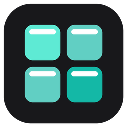
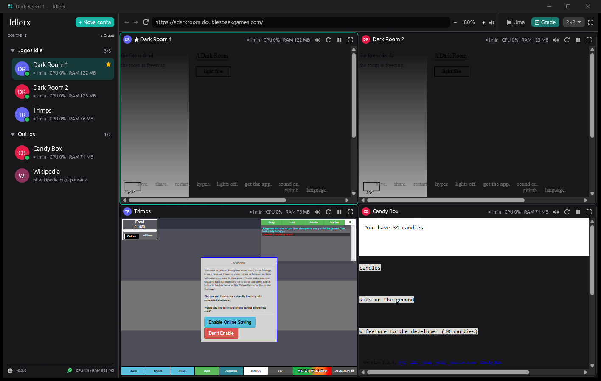
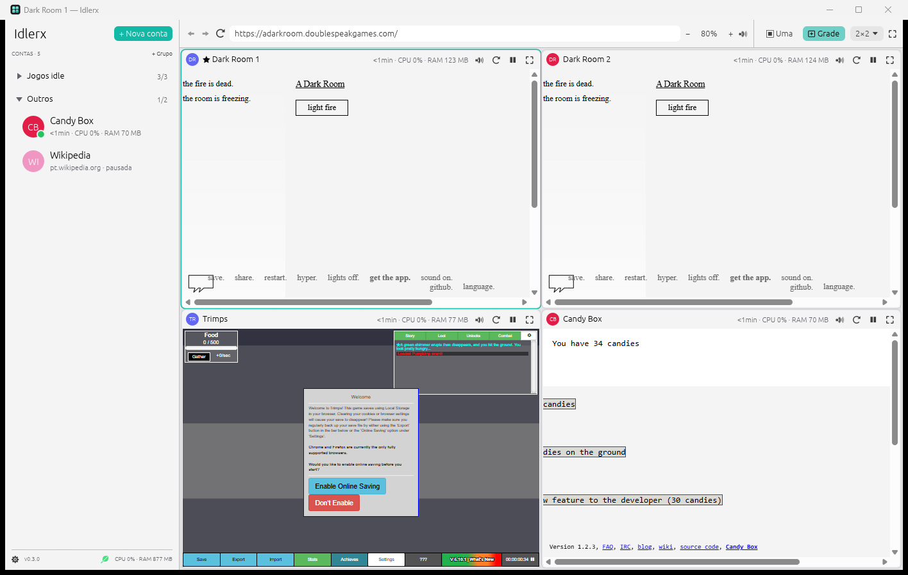
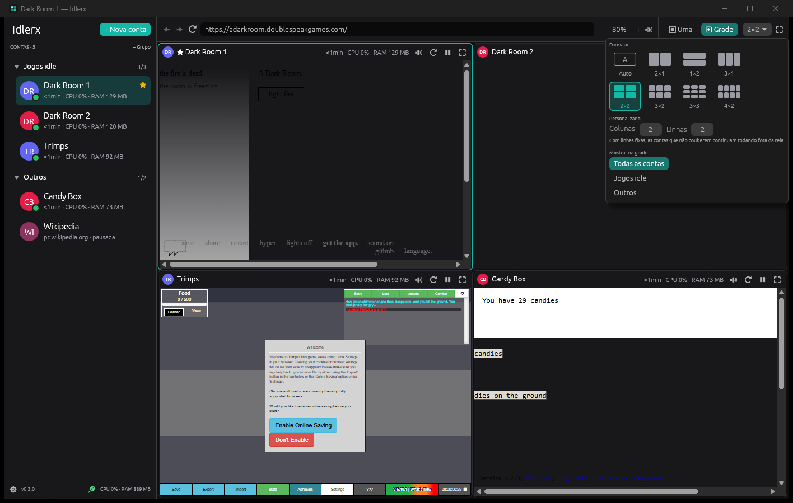
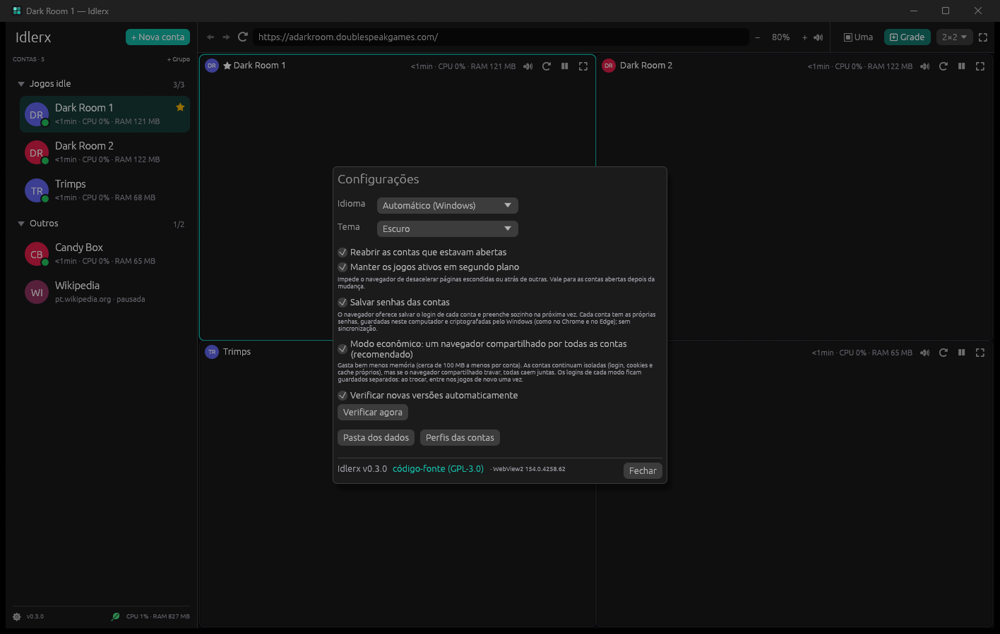

<p align="center">
  
</p>

<h1 align="center">Idlerx</h1>

<p align="center"><a href="README.md">English</a> | <b>Português</b></p>

<p align="center">
  <a href="https://github.com/Antxj/Idlerx/releases/latest"></a>
</p>

Aplicativo para Windows que abre **várias contas do mesmo site ou jogo ao
mesmo tempo**, cada uma **isolada de verdade** (login, cookies, cache e
armazenamento próprios), organizadas numa única janela: uma por vez ou todas
lado a lado numa grade. Feito para quem joga jogos idle de navegador com mais
de uma conta.

**Gratuito e de código aberto** (GPL-3.0). Escrito em **Rust**: um único
executável, sem instalador.

A interface está em português do Brasil e em inglês, seguindo o idioma do
Windows (dá para fixar em **Configurações** ⚙ › Idioma).

| Tema escuro | Tema claro |
|---|---|
|  |  |

| Formato da grade | Configurações |
|---|---|
|  |  |

<sub>Jogos nas fotos: [A Dark Room](https://github.com/doublespeakgames/adarkroom),
[Trimps](https://github.com/Trimps/Trimps.github.io) e
[Candy Box 2](https://github.com/candybox2/candybox2.github.io), todos de
código aberto. Duas contas de "Dark Room" rodam lado a lado, cada uma com o
próprio progresso.</sub>

## Recursos

- **Isolamento de verdade**: cada conta tem a própria pasta de perfil do
  navegador. Dá para logar em duas contas do mesmo jogo ao mesmo tempo, sem
  aba anônima, e uma nunca derruba a outra
- **Modo econômico** (ligado por padrão): um navegador compartilhado por
  todas as contas, cada uma no seu perfil, gastando cerca de 40% menos
  memória. Desligue em **Configurações** para cada conta ter o próprio
  processo de navegador (se uma travar, as outras seguem funcionando)
- **Uma por vez ou em grade**: grade automática que se ajusta à janela, ou
  um formato fixo (lado a lado, empilhado, 2×2, 3×2, 3×3… ou quaisquer
  colunas × linhas). **Arraste uma conta da lista até um quadro** da grade
  para colocá-la ali; a grade também pode mostrar só um grupo
- **Grupos** na lista: **clique num grupo para mostrar só as contas dele na
  grade** (de novo: todas), a seta recolhe/expande, arraste grupos para
  mudar a ordem, arraste contas para dentro, abra ou pause o grupo inteiro
  de uma vez. Uma conta nova já pode nascer num grupo (no diálogo de nova
  conta, ou botão direito no grupo › Nova conta neste grupo)
- **VPN por grupo** (OpenVPN): escolha um arquivo `.ovpn` no grupo e as
  contas dele só acessam a internet pela VPN, com **kill switch**: se a VPN
  cair, elas ficam sem internet até ela voltar, nunca pela sua conexão. O
  resto do computador e os outros grupos não passam por ela. Detalhes em
  [VPN dos grupos](#vpn-dos-grupos)
- **Modo foco** (F11): some com a lista e a barra, fica só o jogo. F11 ou Esc
  traz tudo de volta
- **CPU e RAM** de cada conta (na lista e no quadro da grade), de cada
  grupo (passe o mouse no nome) e o **total** (rodapé da lista; passe o
  mouse para ver os detalhes). A GPU não é medida
- **Áudio e zoom por conta**: silencie uma, dê zoom em outra (também com
  Ctrl+roda do mouse dentro da página). O ícone 🔊 mostra quem está tocando som
- **Barra de endereço** com voltar, avançar e recarregar: é só colar a URL de
  qualquer jogo
- **Favoritar, renomear, reordenar** (arrastando na lista)
- **Senhas salvas** (ligado por padrão): o navegador oferece salvar o login
  de cada conta e preenche sozinho na próxima vez. Cada conta tem as
  próprias, guardadas neste computador e criptografadas pelo Windows, como
  no Chrome e no Edge (sem sincronização)
- **Pausar** uma conta fecha a página e libera a memória; ao abrir de novo
  ela continua logada
- **Limpar dados** (sair da conta) recomeça a conta do zero, sem removê-la
- **Reabre as contas** que estavam abertas, no último endereço visitado
- **Atualizações automáticas** pelo GitHub (detalhes em
  [Atualizações](#atualizações))
- **Bandeja do sistema**: o X manda o Idlerx para a bandeja e os jogos
  continuam rodando (dá para desligar em **Configurações**). Clique no ícone
  para reabrir; o menu dele abre ou pausa todas as contas e sai do
  programa. O ícone ganha um ponto vermelho enquanto a VPN de um grupo
  está fora do ar, e o Windows avisa quando uma VPN cai (depois de 15 s) e
  quando volta
- **Instância única**: abrir o executável de novo só traz a janela para a
  frente (também da bandeja)

### Economia de recursos

- **Limite de quadros por segundo**: jogos idle não precisam desenhar 60
  (ou 144, 180… a frequência do monitor) vezes por segundo. Por padrão
  a conta selecionada desenha até 60 FPS e as outras até 30 (os dois valores
  podem ser mudados nas Configurações); cada conta também pode ter o
  seu (botão direito › Quadros por segundo), e cada quadro da grade mostra
  quantos ela realmente desenha. Com quatro páginas animadas na grade,
  limites de 60 (selecionada) e 15 (outras) levaram a CPU de 25% para 6%

- O **modo econômico** compartilha os processos de navegador, GPU e rede
  entre as contas: com 5 contas, 21 processos e ~1,5 GB em vez de 41 e
  ~2,7 GB. Cada modo guarda os logins separadamente: ao trocar de modo,
  entre nos jogos de novo uma vez
- Páginas fora da tela (outra conta selecionada, menu por cima, **janela
  minimizada**) **param de desenhar** e o WebView2 é instruído a **usar
  menos memória**, mas o jogo continua rodando. Minimizado, o Idlerx gasta
  cerca de dez vezes menos CPU
- "Manter os jogos ativos em segundo plano" (ligado por padrão) impede o
  navegador de desacelerar os timers de páginas escondidas e mantém os
  jogos acordados fora da tela: a página escondida acha que continua
  visível e o loop de desenho dela roda a 5 quadros por segundo, então
  jogos que rodam a lógica nele (Phaser e a maioria dos jogos em canvas)
  não congelam nem se pausam sozinhos. Desligue para economizar ainda mais
  CPU
- Uma página que trava ou para de responder recarrega sozinha (e a conta
  abre de novo se o navegador dela fechou), até 3 vezes em 10 minutos
- A interface só se redesenha quando algo muda (ou 1×/s para os números)
- **Pausar** contas que você não está usando libera toda a memória delas

## VPN dos grupos

Clique com o botão direito num grupo › **Editar (nome, VPN)…** › marque
**Usar VPN (OpenVPN) neste grupo** e escolha o arquivo `.ovpn`. Se a VPN
pedir login, escolha o tipo (usuário e senha, token do Google
Authenticator ou os dois); a senha e a seed do token ficam neste computador,
criptografadas pelo Windows.

- **Ao abrir o Idlerx**, as contas do grupo esperam a VPN conectar e só
  então abrem.
- O **escudo** ao lado do nome do grupo mostra o estado (verde: conectada,
  amarelo: conectando ou reconectando, vermelho: erro); embaixo do nome
  aparecem o **IP** que os sites veem e o **download e upload** do grupo.
  Passe o mouse para ver os totais.
- **Kill switch**: as páginas do grupo só conseguem sair por um "porteiro"
  local preso à placa de rede da VPN. Se a VPN cai, ele corta na hora as
  conexões abertas e recusa as novas; não existe caminho pela sua conexão
  normal. Quando a VPN volta, as páginas recarregam sozinhas.
- **Sem vazamentos**: o DNS é resolvido pela VPN, o WebRTC não revela o IP
  real e o IPv6 fica bloqueado (tudo sai por IPv4 pela VPN). Conferido no
  browserleaks.com (IP, DNS e WebRTC).
- **O resto do computador não muda**: o Idlerx ignora as rotas e os DNS que
  o servidor da VPN manda e adiciona só uma rota pela VPN com a menor
  prioridade possível, usada apenas pelo porteiro do grupo.
- Cada grupo pode ter a sua VPN, ao mesmo tempo.
- No **modo econômico**, as contas de um grupo com VPN usam um navegador só
  delas (cerca de 300 MB a mais por grupo); ao ligar ou desligar a VPN de
  um grupo, entre nos jogos de novo uma vez.

Requer o **OpenVPN Community**. Se ele não estiver instalado, o Idlerx
oferece instalar: o instalador oficial (assinado pela OpenVPN Inc.) vem
dentro do executável, e o Windows pede permissão de administrador. Na
primeira conexão o Windows também pode pedir uma vez para autorizar sua
conta no serviço do OpenVPN; depois disso o Idlerx conecta sem pedir
permissões. A VPN usa o serviço do próprio OpenVPN, então funciona junto
com outras VPNs (inclusive o OpenVPN GUI).

## Requisitos

- **Windows 10 ou 11**
- **Microsoft Edge WebView2 Runtime**: já vem no Windows 11 e é instalado
  pelo Windows Update no Windows 10. Se faltar, o Idlerx mostra um aviso com
  o link oficial da Microsoft

O Idlerx usa o motor do Microsoft Edge (Chromium), então os sites se
comportam como no Edge ou no Chrome.

## Como usar

1. Baixe o `Idlerx.exe` na página de [Releases](../../releases)
2. Abra. Na primeira vez, o SmartScreen pode avisar sobre "aplicativo não
   reconhecido": clique em **Mais informações** › **Executar assim mesmo**
3. **+ Nova conta**: cole o endereço do jogo e dê um nome (ex.: "Char
   principal")
4. Repita para as outras contas e escolha **▣ Uma** ou **⊞ Grade** no canto
   superior direito

Clique com o botão direito numa conta para mais opções (editar, silenciar,
tirar da grade, limpar dados, remover).

## Para desenvolvedores

Requisitos: [Rust](https://rustup.rs) com o toolchain **MSVC** e o Visual
Studio Build Tools. O toolchain GNU não serve (o loader do WebView2 viraria
uma DLL separada); se ele estiver ativo, o build para com uma mensagem.

```powershell
cd rust
rustup override set stable-x86_64-pc-windows-msvc   # só se o MSVC não for o seu padrão
cargo test
cargo run
.\build-release.ps1      # instalador do OpenVPN + testes + release sem caminhos locais + verificações
```

Estrutura:

- [`main.rs`](rust/src/main.rs): inicialização e janela
- [`app/`](rust/src/app/mod.rs): interface (egui), dividida em lista
  lateral, barra superior, grade, diálogos e peças compartilhadas
- [`panels.rs`](rust/src/panels.rs): uma conta aberta (WebView2 via
  [webview2-com](https://github.com/wravery/webview2-rs), criado de forma
  assíncrona): posição, mudo, zoom, navegação
- [`config.rs`](rust/src/config.rs): contas e configurações (JSON)
- [`metrics.rs`](rust/src/metrics.rs): CPU e memória por árvore de processos
- [`i18n.rs`](rust/src/i18n.rs): idioma e as macros `tr!`/`trf!`
- [`update.rs`](rust/src/update.rs): verificação e instalação de versões novas
- [`vpn/`](rust/src/vpn/mod.rs): VPN dos grupos: OpenVPN pelo serviço
  dele, o porteiro (proxy SOCKS5 preso à placa da VPN, kill switch), DNS pelo
  túnel, instalador embutido
- [`single.rs`](rust/src/single.rs): instância única

Variáveis úteis para testes:

| Variável | Efeito |
|---|---|
| `IDLERX_DATA` | guarda configurações e perfis em outra pasta (não mexe nas contas reais) |
| `IDLERX_INSTANCE` | separa uma instância de teste do app de uso diário |
| `IDLERX_LANGUAGE` | força `pt` ou `en` |
| `IDLERX_UPDATE_URL` | consulta outro endereço em vez da API do GitHub |
| `IDLERX_SCREENSHOT` | abre numa tela específica para as fotos da documentação: `settings`, `grid-menu`, `group`, `new-account` ou `pointer:x,y` (ponteiro parado ali) |

## Onde ficam os dados

- Configurações e lista de contas: `%APPDATA%\Idlerx\config.json`
- Registro das páginas: `%APPDATA%\Idlerx\logs\pages.log` (quando cada
  conta carregou, recarregou e por quê, ficou escondida ou visível;
  **Configurações** › Registro das páginas)
- Perfis do navegador (cookies, cache, logins) de cada conta:
  `%LOCALAPPDATA%\Idlerx\profiles\`
- VPN dos grupos: `%APPDATA%\Idlerx\vpn\` (cópia de cada `.ovpn`,
  senhas e seeds criptografadas pelo Windows em `secrets.dat`, logs do
  OpenVPN em `logs\`)

Os dados das contas **nunca saem do computador**.

## Atualizações

Não há servidor próprio: o app consulta
`api.github.com/repos/Antxj/Idlerx/releases/latest` logo ao abrir e
depois a cada hora (dá para desligar em **Configurações**). A
requisição não envia nenhum dado do usuário.

Quando há versão nova, aparece um link discreto na barra superior. Em
**Atualizar agora**:

1. o `Idlerx.exe` da release é baixado e só é aceito se tiver exatamente o
   SHA-256 que o GitHub publica para o arquivo;
2. se o executável atual for assinado digitalmente, o novo precisa ter
   assinatura válida **do mesmo editor**;
3. o executável atual vira `Idlerx.exe.antigo` (apagado na próxima
   inicialização) e o novo toma o lugar;
4. o app fecha e a versão nova abre sozinha, com as mesmas contas.

## Privacidade

O Idlerx não coleta nem envia dados. As únicas conexões são os **sites que
você abre**, a **verificação de versões** no GitHub (descrita acima) e, nos
grupos com VPN, o **servidor da sua VPN** e uma consulta a
`api.ipify.org` **pela própria VPN** a cada conexão, para mostrar o IP que
os sites veem (e conferir que o túnel funciona antes de liberar as
páginas).

## Uso responsável

O Idlerx organiza sessões de navegador; ele **não automatiza ações** nos
jogos nem captura credenciais. Respeite os termos de uso de cada jogo,
inclusive quanto ao uso de várias contas.

## Desinstalar

Feche o app e apague o `Idlerx.exe`. Para remover também as contas e os
perfis, apague as pastas `%APPDATA%\Idlerx` e `%LOCALAPPDATA%\Idlerx`.

## Conferindo o download

Cada release é gerada exclusivamente pelo
[workflow de release](.github/workflows/release.yml) no GitHub Actions, a
partir do código deste repositório. Compare o SHA-256 da sua cópia com o
mostrado na página de [Releases](../../releases):

```powershell
Get-FileHash .\Idlerx.exe -Algorithm SHA256
```

E confira o atestado de origem (assinado pelo GitHub) com o
[GitHub CLI](https://cli.github.com):

```powershell
gh attestation verify .\Idlerx.exe --repo Antxj/Idlerx
```

## Licença

[GPL-3.0-or-later](LICENSE). Componentes de terceiros e suas licenças estão
em [THIRD-PARTY-LICENSES.txt](THIRD-PARTY-LICENSES.txt).
